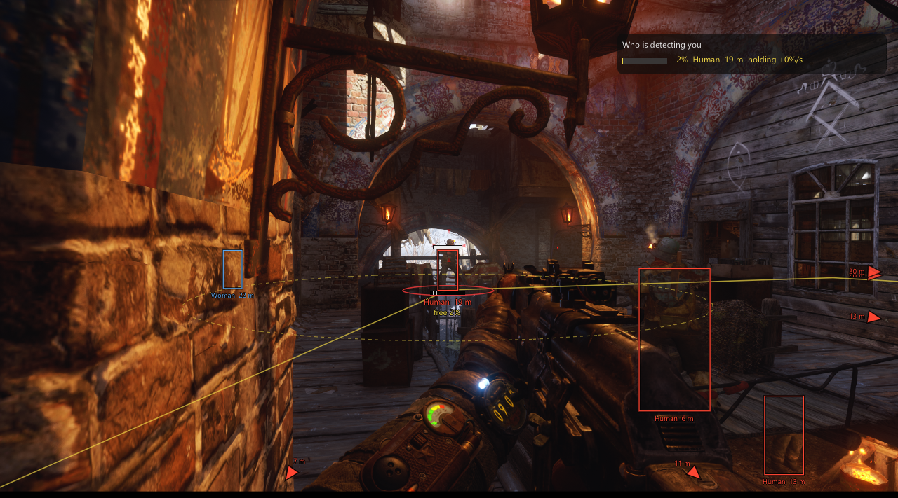
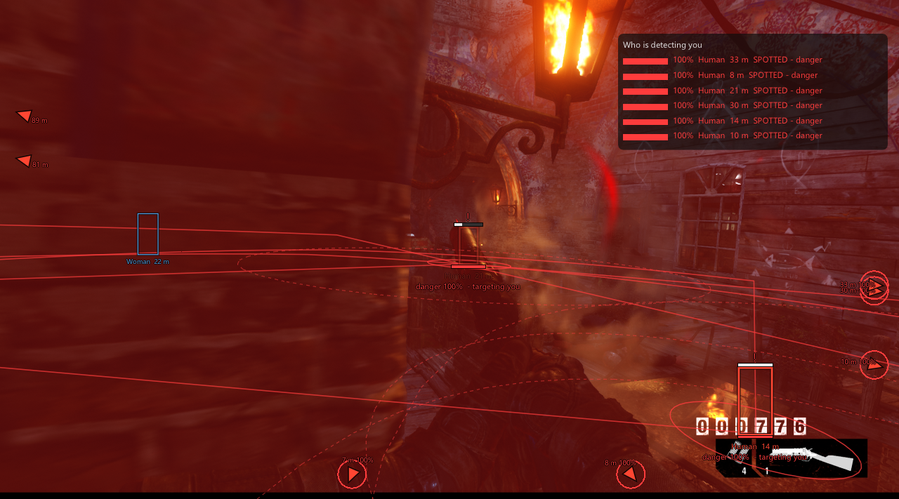
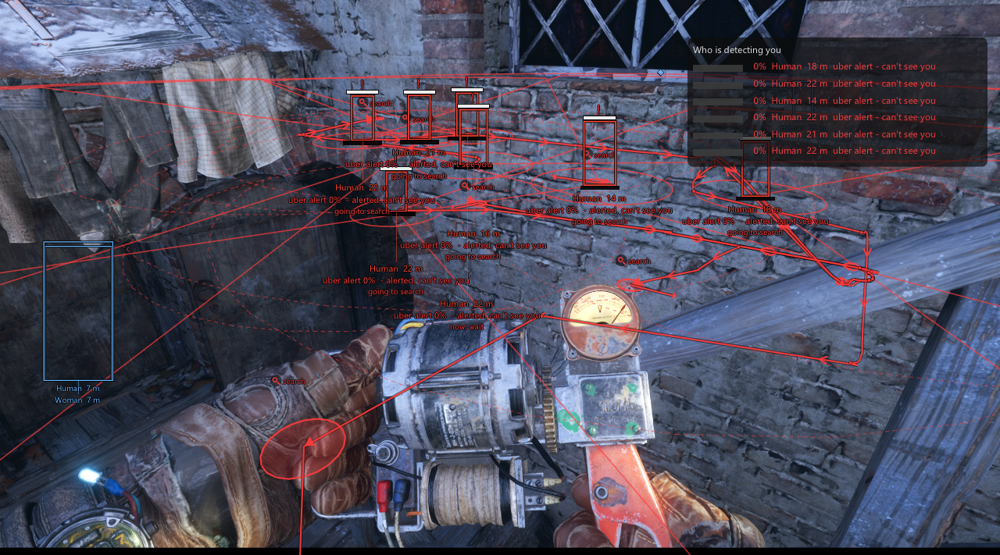
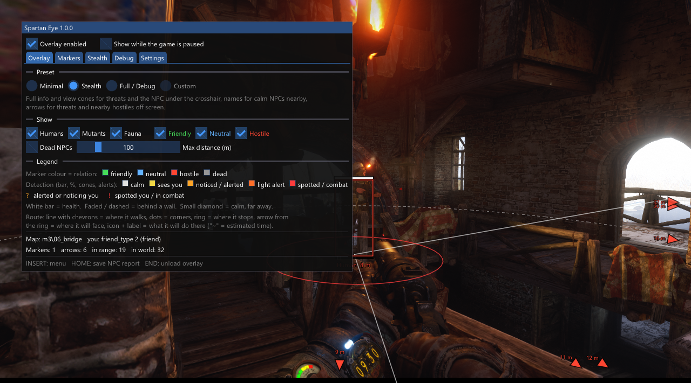

# Spartan Eye - NPC & Stealth Overlay

**Оверлей NPC и скрытности для Metro Exodus Enhanced Edition (Steam).** Показывает всех NPC сквозь стены: дистанцию,
здоровье, состояние ИИ и — по данным зрения самой игры — насколько близко каждый из них к тому, чтобы вас заметить.
Также видно, куда NPC идут и что будут делать на месте.

*Только для одиночной игры. Только чтение: не изменяет данные игры, файлы игры и сохранения.*

[English version](README.md)



## Возможности

- **Метки сквозь стены** для людей, мутантов и животных: рамка (или уголки), имя, дистанция, полоска здоровья.
- **Цвет по отношению к вам** — по правилу «друг/враг» самой игры: дружественные зелёные, нейтральные синие,
  враждебные красные, мёртвые серые.
- **Состояние ИИ**: спокоен / встревожен / бой; `?` — встревожен или замечает вас, `!` — заметил вас.
- **Точный индикатор обнаружения**: собственное значение зрения NPC для вас относительно его текущего порога
  «заметил». 100 % — момент, когда NPC реагирует. Данные берутся из движка, а не угадываются.
- **Список «Кто вас замечает»**, баннер (по желанию со звуком), когда NPC замечает вас или берёт на прицел, и панель
  «почему»: ваша заметность (свет, поза, скорость, растительность) и члены формулы для NPC, который видит вас лучше
  всех.
- **Конусы зрения** по реальным данным NPC: дальность, угол обзора, дальность на краю, круговая зона, зона
  мгновенного обнаружения.
- **Прямая видимость**: NPC, которые сейчас вас видят, — сплошные, за укрытием — полупрозрачные или пунктирные.
- **Маршруты и намерения**: путь, по которому идёт NPC, точка остановки, куда он там повернётся и что будет делать
  (точка патруля, укрытие, проверить, обыскать, осмотреть тело…), с примерным временем прибытия.
- **Стрелки по краю экрана** для угроз за кадром или за спиной.
- **Пресеты**: *Минимальный*, *Скрытность* (по умолчанию), *Полный / отладка*. «Умная детализация» показывает полную
  информацию только там, где это важно: угрозы и NPC под прицелом.
- **Фильтры**: люди / мутанты / фауна × дружественные / нейтральные / враждебные, максимальная дистанция.
- **Вкладка Debug**: сырые значения движка, триггерные / скриптовые зоны в виде коробок, отчёт по NPC в текстовый
  файл (HOME).
- Автоматически скрывается на экранах загрузки и в меню паузы. Все настройки сохраняются в ini-файле рядом с DLL,
  клавиши можно переназначить.

| Бой | Маршруты | Меню |
|---|---|---|
|  |  |  |

## Требования

- **Metro Exodus Enhanced Edition в Steam**, сборка игры **24973569** (`MetroExodus.exe` 2.0.0.1). С другими
  сборками оверлей не загружается и выводит понятное сообщение. Это относится к другому патчу Steam, версиям Epic и
  GOG и оригинальному изданию 2019 года. См. [После обновления игры](#после-обновления-игры).
- Windows 10 или 11, 64-бит. Любая видеокарта, на которой идёт игра (NVIDIA, AMD, Intel), DLSS вкл./выкл., любое
  разрешение, соотношение сторон и режим окна.
- Больше ничего ставить не нужно: никаких библиотек и установщика, в папку игры ничего не копируется.

## Установка и запуск

1. Скачайте `SpartanEye-1.0.0.zip` и распакуйте в любую папку с правом записи (Документы, Рабочий
   стол…). Не в `Program Files`: оверлей хранит настройки и лог рядом с собой.
2. Запустите **`SpartanEye.exe`**. Он запустит игру через Steam и дождётся окна игры. Затем он загрузит оверлей и
   закроется. Если игра уже запущена, он только загрузит оверлей.
3. В игре короткое сообщение подтвердит загрузку. **INSERT** — меню.

По желанию: один раз запустите `Create desktop shortcut.cmd`, чтобы получить ярлык на рабочем столе, который делает
шаг 2.

Командная строка: `SpartanEye.exe --inject` (только загрузить в запущенную игру), `--unload`, `--shortcut`.

**Удаление:** нажмите END в игре (или закройте игру) и удалите папку и ярлык. Больше ничего не остаётся: ни записей в
реестре, ни файлов в папке игры или сохранений.

## Клавиши

| Клавиша | Действие |
|---|---|
| INSERT | Открыть / закрыть меню (пока оно открыто, игра не получает мышь и клавиатуру) |
| HOME | Сохранить отчёт по NPC (все NPC в радиусе, с сырыми значениями) в `metro_npc_reports.log` |
| END | Выгрузить оверлей (игра продолжает работать) |

Переназначить: меню → *Settings → Keys*.

## Что вы видите

| Элемент | Значение |
|---|---|
| Цвет метки | Отношение к вам: зелёный — друг, синий — нейтрал, красный — враг, серый — мёртв |
| Жёлтый → оранжевый → красный | Обнаружение / состояние ИИ: видит вас, заметил / встревожен, лёгкая тревога, заметил вас / бой |
| `?` / `!` | Встревожен или замечает вас / заметил вас, бой |
| Полоска и % обнаружения | Значение зрения NPC для вас ÷ его текущий порог «заметил». Засечки — уровни «замечает» и «лёгкая тревога». `~` — оценка по состоянию ИИ (у этого NPC нет данных зрения) |
| «Alerted, can't see you» | Встревожен чем-то другим: звук, тело, тревога товарища или потерял вас из виду |
| Полупрозрачная / пунктирная метка | За укрытием: ИИ NPC сейчас вас не видит |
| Белая полоска | Здоровье |
| Маленький ромб | Спокойный NPC вдалеке (умная детализация) |
| Линия маршрута с шевронами | Куда идёт NPC. Точки — повороты, кольцо — место остановки, стрелка от кольца — куда он там повернётся |
| Значок и подпись у остановки | Что он будет там делать. `~12 s` — примерное время прибытия |
| Конус на земле | Зрение NPC. С обводкой, когда NPC в бою, заметил вас или вы стоите внутри конуса |

Та же легенда есть на вкладке *Overlay* в меню (интерфейс оверлея на английском).

## Пресеты

- **Minimal**: маленькие метки. Полная информация только для NPC, которые вас замечают, встревожены или под прицелом.
  Без конусов.
- **Stealth** (по умолчанию): полная информация и конусы для угроз и NPC под прицелом, имена спокойных NPC рядом,
  стрелки для угроз и ближайших врагов за кадром, маршруты для угроз и NPC под прицелом.
- **Full / Debug**: всё для всех NPC, с сырыми значениями движка. Перегружено, но для проверки и отладки.

Если изменить любую настройку вручную, пресет станет *Custom*. Выберите пресет, чтобы вернуться.

## Файл настроек

`metro_npc_overlay.ini` рядом с DLL. Оверлей записывает его при каждом изменении. Редактировать можно при закрытой
игре. Удалите файл, чтобы сбросить всё по умолчанию. То же делает кнопка меню *Settings → Reset to defaults*.

## После обновления игры

Оверлей поддерживает ровно одну сборку игры. Когда Steam обновит игру, лаунчер сообщит *«unsupported game
version»* и ничего не загрузит. Игре это ничем не грозит. Следите за новой версией на этой странице.

Для разработчиков: все адреса игры находятся при запуске по сигнатурам байтов (каждая должна совпасть однозначно,
или несколько должны совпасть между собой). Небольшой патч их часто не ломает. Чтобы попробовать новую сборку:
укажите в `src/version.h` в `GAME_BUILD_TIMESTAMP` PE-метку времени нового `MetroExodus.exe` и пересоберите. Затем
посмотрите `metro_npc_overlay.log`: там перечислены все найденные адреса или сигнатура, которая не совпала. Все
структуры и сигнатуры описаны в `docs/ENGINE_NOTES.md` (на английском).

## Решение проблем

- **Лог:** `metro_npc_overlay.log` рядом с DLL (лог прошлого запуска — `metro_npc_overlay.old.log`). Лаунчер тоже
  выводит итог от самого оверлея.
- **Предупреждение антивируса:** лаунчер загружает DLL в игру через `CreateRemoteThread` + `LoadLibrary`. Так
  работает большинство оверлеев, трейнеров и загрузчиков модов, и некоторые антивирусы помечают это эвристикой.
  Файлы не подписаны. Весь исходный код здесь, у архива релиза есть контрольная сумма SHA-256, и всё можно собрать
  самому (см. ниже). Если антивирус удалил DLL, лаунчер об этом скажет.
- **«cannot open the game process»:** игра запущена от администратора. Запустите лаунчер тоже от администратора
  (или оба без).
- **Нет меток:** откройте меню (INSERT). Нижняя строка объясняет, почему ничего не рисуется (загрузка, пауза, нет
  игрока…).
- **Папка без права записи:** лаунчер предупредит. Перенесите папку из `Program Files`.

## Только одиночная игра

Metro Exodus — одиночная игра без античита. Оверлей только читает память игры. Он рисует через перехват вызова
present DirectX 12 и перехватывает DirectInput лишь для того, чтобы клавиши не доходили до игры, пока открыто его
меню. Он никогда не записывает данные игры и не трогает папку игры, сохранения и онлайн-сервисы. Используйте только
в одиночной игре.

## Сборка из исходников

Нужны Visual Studio 2022 или Build Tools for Visual Studio 2022 (нагрузка *Разработка классических приложений на
C++*: MSVC v143 и Windows 10/11 SDK). CMake 3.25+ входит в Visual Studio.

```
cmake -S . -B build -G "Visual Studio 17 2022" -A x64
cmake --build build --config Release
python tools/package_release.py        # по желанию: архив релиза + SHA-256 в dist/
```

Результат: `build/Release/SpartanEye.exe` и `metro_npc_overlay.dll`. CRT слинкован статически, поэтому сборке
не нужны библиотеки времени выполнения. GitHub Actions в репозитории собирает тот же архив при каждом push.

## Известные ограничения

- Обнаружение учитывает **зрение**. Слух не показывается.
- Прямая видимость — это собственное «наблюдение» ИИ за вами. Пока у NPC нет причины искать вас, она «неизвестна»
  (по умолчанию рисуется как видимый).
- Периферийная зона приблизительная: игра использует направление головы, а оверлей рисует её от корпуса.
- Подробно проверено на уровнях Москвы / Мёртвого города и Волги. Нейтральные фракции, которые становятся
  враждебными, и поздние уровни не проверены.
- Время прибытия на маршрутах — оценка (длина пути ÷ недавняя скорость), помечено `~`.

## Благодарности

- [MinHook](https://github.com/TsudaKageyu/minhook) (BSD 2-Clause), [Dear ImGui](https://github.com/ocornut/imgui)
  (MIT) и stb (MIT). См. [THIRD_PARTY_LICENSES.md](THIRD_PARTY_LICENSES.md).
- Реверс-инжиниринг в [Ghidra](https://github.com/NationalSecurityAgency/ghidra). Заметки о камере оригинального
  издания в [TefMeister/metro-exodus-vr](https://github.com/TefMeister/metro-exodus-vr) стали хорошей отправной
  точкой.
- **Об использовании ИИ:** мод разработан с помощью Claude Code (Anthropic) как агента для программирования и
  реверс-инжиниринга, под руководством и с тестированием в игре от root.
- Проект не связан с 4A Games, Deep Silver или PLAION и не одобрен ими. Metro Exodus — товарный знак
  правообладателей.

## Лицензия

[MIT](LICENSE) © 2026 root
